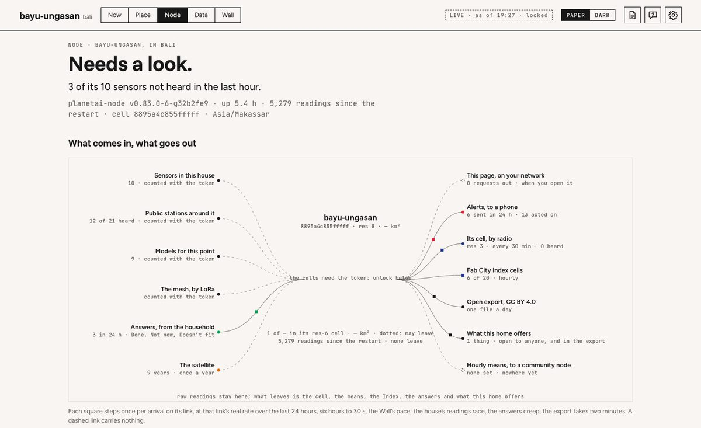
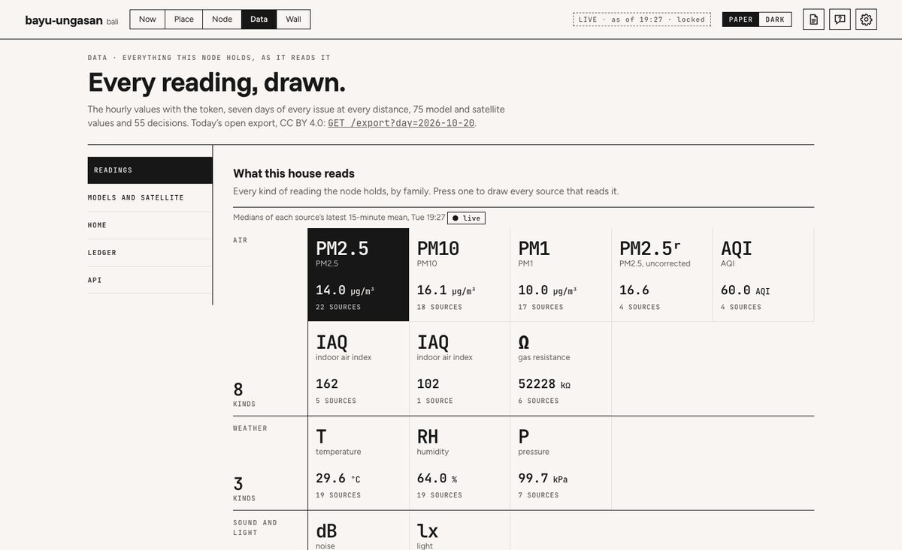
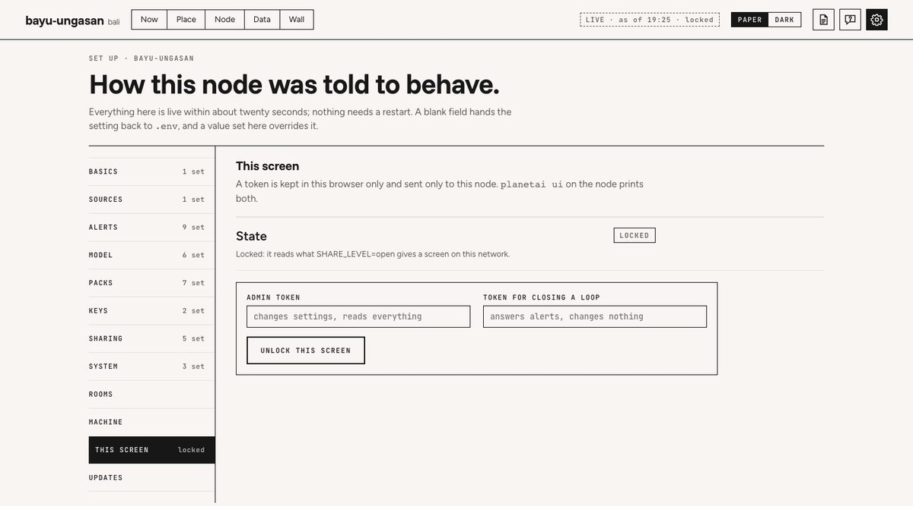
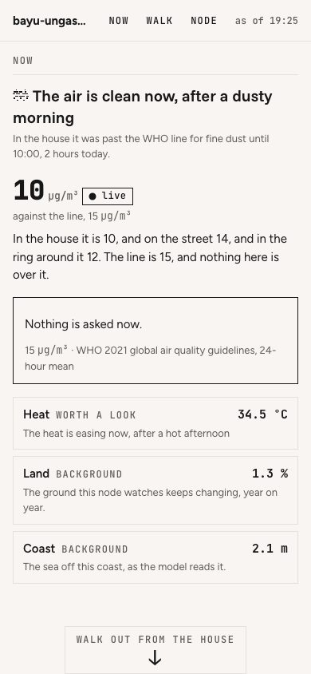

# The dashboard
<!-- checked: v0.83.0 -->

The dashboard is where a household reads its node: what it observed about the place, what it asks of the people
there, whether that worked, and what the machine itself is doing. The node computes and the page draws, so every
sentence, number and state word on it comes from the node's routes. A number the page worked out for itself would be
a bug.

The address `/` opens one of three pages:

| address | what it opens |
|---|---|
| `/` | the five doors, Now, Place, Node, Data and Wall, with Set up behind the gear. The default |
| `/?layout=mobile` | the phone page, one column. A phone opening `/` is moved here on its own, see [The phone page](#the-phone-page) |
| `/?layout=classic` | the classic dashboard, with its ladder, its three modes and its six views, see [The classic dashboard](#the-classic-dashboard) |

All three read the same routes with the same token, kept in the browser as `planetai_admin` (the admin token) or
`planetai_act` (the token for closing a loop, which can answer the node and change nothing). Every file the pages load,
scripts, stylesheets, fonts and the vendored map and drawing libraries, is served by name from `GET /static/{name}`,
so the dashboard draws on a network with no route out.

## A first read

1. **Open it.** `planetai ui` prints the addresses (`On this machine: http://localhost:8080/`, `On your network:
   http://<ip>:8080/`, and the tailnet address once `planetai mesh` has run) and both tokens. Open one. While the
   page loads it shows **Asking the node**: each route it asked, with its time in milliseconds or `no answer`. A
   `no answer` row is the part of the node that is not answering. Nothing on that screen is a reading yet.
2. **Unlock the screen.** At `SHARE_LEVEL=off`, the default, a browser without a token gets "This node is not
   sharing its readings with this screen." and two fields. Paste the admin token and press **Unlock this screen**.
   To let every screen in the house read the node without a token, set `SHARE_LEVEL` to `open` in Set up › Sharing
   (see [Sharing](sharing.md)).
3. **Read Now.** The bar shows the node's name and the five doors. Now opens on the headline issue: its sign, the
   node's sentence, and its day drawn at every distance against the line. The four distances (house, street, ring,
   region) follow in one line, each with its provenance word.
4. **Answer what is asked.** If the node is asking something, **What to do** holds a framed card with the action it
   chose and **Done**, **Not now** and **Doesn't fit**. Press the one that is true. The page says "Recorded.", or for
   Not now, that the node holds the question for three hours unless it reaches danger. If it says the screen can't
   answer yet, the screen holds no token: unlock it in Set up › This screen. When nothing is asked the section reads
   "Nothing is asked now."
5. **Find the record.** Data › Ledger has your answer at the top, with its stage and time. On Node, **What it
   remembers** keeps the diary and what the node learned about what works here.
6. **Look around.** Place is the ground as a map. Node says whether the machine is working and what leaves it. Wall
   is the screen for a room, read from three metres.

## The bar and the foot

The bar runs along the top of every door but the Wall: the node's name and place, the five doors in the order Now,
Place, Node, Data, Wall, then an as-of line (`LIVE · as of 19:00`, or `CAPTURE` on a fixture, with `· locked` on a
screen without a token), the **Paper** / **Dark** switch, the documentation, **Ask the node** and the gear for Set up.
When a newer release is out, one small line says so ("v0.84.0 is out") and opens Set up › Updates. On a phone the bar
also offers **Phone view**.

The register is kept in this browser as `planetai_theme`; with nothing kept the doors follow the system's setting. The
Wall is always dark.

The foot closes every door but the Wall: what the node is in one line, its version, the documentation and "These pages,
explained" (this page), `llms.txt` for agents, Ask the node, Set up, **Unlock this screen**, today's open export (CC BY
4.0) and links to PLANETAI, Fab City and the source.

> **Gap in v0.83.0.** The doors read the node when the page opens, and again only after an answer on Now or an
> unlock; nothing re-reads it while the page stays open. A Wall left on keeps the figures of the moment it was opened,
> and only its narration is new every ten minutes. Reload the page, or use the classic wall, which re-reads on
> `POLL_SECONDS`.

## Now

Now reads in the order a household asks.

**Right now.** A kicker ("Right now · Heat at 19:00" and the provenance pill), then the sentence and the day as one
block: the issue's sign, the node's title (no number in it) with its tagline smaller beneath, and the
[day figure](#the-day-figure) with the week under it. The kicker links to the node's cell on Place ("497 m · 0.64 km²
›"). The four distances follow as one quiet line; a distance with no reading says `none` or `not recorded`. Point at
an hour, drag across the day, or use the arrow keys (left and right an hour, up and down a day, End for now): the
sentence, the distances and Decide follow the hour, and **Back to now** returns.

**What to do.** While the node is asking (`asking` on the issue in `/issues`), a framed card: the issue, the kind of
event and when it began, the peak against the line, the action the node chose in its own words, and **Done**, **Not
now** and **Doesn't fit**. Once somebody has answered, the buttons go and the line under the card says who answered,
when, and when a Not now asks again. An alert still true that no event stands for is drawn the same way, without
buttons, because it is answered on Telegram. When nothing is asked the section is one plain line, "Nothing is asked
now.", with the hour this issue is usually worst for a screen holding the admin token. A past hour shows what was open
then, and is read, never answered. An issue with no line says the node only reports it and never asks you to act.

**Did it work** and **Yesterday** (admin token only). For the issue on screen: the last time the node asked, what was
done, what the air or heat inside did in the hours after against the street, and the node's verdict from what it
learned ("It helps here.", "No clear difference here yet.", "Too early to say."), with who it matters to, or a link to
say who lives here. Yesterday is the node's diary entry for yesterday, condensed from its own numbers, with a link to
the whole entry on Node.

**Around the house.** A row for each issue drawn by the hour, its state word, its value now and its hours over the line
today; pressing one moves the page to that issue. Under them, the map of the stations around the house: each public
station with its 15-minute mean, a red square beside one over the air's line, the house as one mark with its own
sensors' range, and the distance rings and cells for a screen with the token. Pressing a station opens it in Data.
Without WebGL the map is a rose of bearings and distances. With the admin token one line counts the things this home
keeps, how many sit idle and how many need repair, and opens Data › Home.

Land and coast change yearly and have no hours, so they are on Place, under **What is changing**. Now opens on the
headline issue when it is drawn by the hour, else on the first issue that is. Under 480 px everything is one column,
the bar is three rows of 44 px targets, and the week is one row a day, the whole row a target.

## The day figure

Each issue with a day has one drawing of its last 24 hours. Every distance is a trace, the house heavier, and an hour
with no record is a gap in its trace. The grey band is the usual for each hour, from the
node's own last 14 days.

The red dashed line is the issue's line, labelled in ink (`WHO 15` for PM2.5, the WHO 2021 24-hour guideline), and red
ticks along the floor mark the hours over it. Hours not yet come are hatched. An alert event is a bar from when it
opened to when it cleared, and its answer is a ring, green for Done. A reading above the scale is clipped and printed,
so one spike cannot flatten the day. The line under the drawing says the hour in words.

## The strips

One row a day and one cell an hour, the newest day at the bottom: the last seven days under each day figure, and every
day the node holds on Historical.

A darker cell is a higher reading on that issue's own scale. An hour over the line is an ink cell with a red tick on
top, and an hour nothing was recorded is left empty. The figure at the end of each row is the node's own count of
hours over the line that day, from `GET /issues/days`.

## Place

The ground this node stands on. The head gives the cell's id, resolution, edge and area (and the node's position, for
a screen with the token), and three views:

| view | what it draws |
|---|---|
| **Map** | every layer with a position, on the node's own street map |
| **From orbit** | the node's Sentinel-2 annual medians, then and now side by side, with the hectares that changed between them by its AlphaEarth record |
| **What changed** | the hectares that changed year on year (one square per 10 ha), and what the ground within 1 km is made of: built, trees, crops, water, by satellite |

**The map.** Eighteen layers in five groups sit in a strip above it: **Base** (the street map, satellite at 10 m,
drone imagery), **Grid** (H3 cells at the scale in view, the cell the node stands in, what leaves by radio),
**Readings** (this house's stations, public stations, model points, distance rings), **Images** (the household's
images and the species confirmed in them) and **Packs** (buildings only the satellite knows, the wind, places to make,
and three that have no shape on a map: the land change raster, the Index cells and nodes heard nearby, each saying
where it is drawn instead). Each row has its swatch, what it draws and from where, its pack and its opacity. Five start
on: the street map, the node's cell, the house's stations, the public stations and the images. A layer whose pack has
nothing here says so.

Nothing is labelled on the map itself: every mark leaves on a thin leader to a ruled margin, **At the house · by
position**, one row per mark with its distance in metres from the node, measured by the node (`GET /geo/measure`, and
`GET /nearby` for public stations). The inspector is one line under the map. With nothing pressed it says what is in view;
press a station, an image, a place to make or a cell and the line gives its facts, and with the token how far it is
from the node and which cell it is in. A station of this house says it counts toward the cell; a public one is shown
and never counted. The scale rail (Street, Block, Cell,
Village, District, Island, Radio) and the tools sit on the map: zoom, back to the node's cell, **Inspect**, **Measure**
with **Done**, **From the house**, and save as PNG. The resolution drawn follows the zoom, and rungs 6 and coarser, the
cells that may leave the machine, are dotted.

The grid, the rings and every distance are the node's own answers from `GET /geo/*`, and the plan is
`GET /place/geojson`; all of them need a token at every sharing level, because together they place the house. Without
the token, the house's marks say **withheld** where they would stand and the map opens on the published cell. The
street map comes from `/ground/*` once `planetai run place basemap` has run; until then Set up lists **The map of this
place** under what is left to finish.

**+ Add an image** (token only) opens a dialog: the file, what took it (phone, fixed camera, microscope, drone, balloon
or kite), a note and your name, and whether the image model on this node describes it. The image lands where its own
GPS says it was taken, else in the node's cell; the node strips EXIF and GPS from the file and keeps it.

Below the map, three columns. **Where the readings come from**: how far back each kind of source reaches, from
`GET /reach`, and the public stations within 5 km. **Species confirmed here**: a table of what somebody here confirmed
in an image, how often, where, and GBIF's open records by others in the node's seven cells, token only. **What is
changing**: land and coast with the node's sentence and figure, the Index cells, and what is not here yet (production
and trade, water and soil).

## Node

Node opens on a verdict: "Working. Last reading 19:19; 6 of 6 sensors, 10 of 20 stations heard in the last hour." A
poll older than 15 minutes, a loop that failed on its last run, a sensor of its own not heard in the last hour, or,
with the token, a fundamental source not running (`GET /health/sources`) turns it into "Needs a look", saying which,
with a link to finish setting up. Under it, the version, uptime, readings since the restart, the cell and the time zone.

| part | what it holds |
|---|---|
| **What comes in, what goes out** | the node as a hexagon, its sources on one side and what leaves on the other, replaying the last six hours in 30 s (24 hours on a press). Drawn vertically under 700 px |
| **Fab City Index cells** | the Index cells this node computes from its hourly buckets, "N of 20", each with its value and provenance word |
| **What it remembers** | admin token only, and never leaves the machine: the **Diary** as a table by day, week, month or year, each entry opening as the node wrote it, with a search; **What is usual** (the shape of the day inside and out, the week against the three before); **What worked**, per alert, the change inside when somebody acted and when nobody did, and the node's verdict; **Who lives here?**, five boxes that rank the learnings by who they matter to. `#node/remember/day/<date>` opens one entry |
| **The nodes around it** | the nodes listed and heard by radio, then a globe at most a third of the screen high |
| **Running** | the version and schema, how long since the restart and the polls since, then, with the token, the processor, memory, temperature and disk, with how long the disk lasts, and the mesh in the house |
| **What this node will not do, at any stage** | the five refusals in plain words, each beside a link to where it can be checked |

## Data

Every reading the node holds, one tab at a time, routed `#data/<tab>`. The tab bar is sticky; on a phone it wraps into
44 px targets.

| tab | what it shows |
|---|---|
| **Readings** | every kind of reading as a tile, with the median of its sources' 15-minute means now. Press one to draw every source that reads it over 24 hours on one scale, each linked to where its source publishes it (the hourly table needs the token). Then every issue at every distance over seven days, and the hours over the line per day |
| **Models and satellite** | one table: a row per value the models and the satellite give for this point, how often it is fetched, its unit |
| **Home** | **Images**, newest first: when and who, what took it, the note, what the image model saw and whether somebody here confirmed it. A row opens the image to edit, confirm or delete. Then the species confirmed, and **Things**, what this home keeps, how often each is used, its state and whether it is offered (admin token) |
| **Ledger** | every decision, newest first, a run of the same answer as one row ("decided ×10"), who answered in words, and a filter by stage. Without a token, only the time and the stage |
| **API** | every route on this node, one line each, with a search |

`#data/<sensor-id>` opens a station in Readings. The diary and the Index cells are on Node.

## Wall

The keeper's one screen for a room, always dark, read from about three metres and operated by nobody. Its map walks
out from the house a scale at a time, house, street, ring and region, and under it the node's model says in plain
words what is happening. It names no sensor, room or person, and shows what is asked without a button to answer it.
[Wall mode](wall.md) has all of it.

## Set up

The gear opens Set up, a page of its own with a sticky list of sections. The first eight are the setting groups;
the last four are about this screen and this machine.

| section | what is in it |
|---|---|
| **Basics** | what this place watches, in order; what kind of node it is; its language; how the page opens. Name, city, position and time zone are read once at start: edit `.env`, then `planetai restart` |
| **Sources** | your sensors and accounts, the public stations and portals around you. A source that comes as a pack is set in its card under Packs |
| **Alerts** | reports at the hours you choose, what interrupts between them, quiet hours, which engine sends the heat and air messages (`ALERT_ENGINE`), how many it may send a day (`ALERT_MAX_PER_DAY`), what this home has (`HOME_HAS`), mesh alerts, and whether an act needs a decision first |
| **Model** | which model answers, on the ask pane and on Telegram alike |
| **Packs** | which packs load, and one card per pack with its switch, what it is and its own settings; a key the pack lists under `secrets:` is masked once saved |
| **Keys** | every secret, masked once saved and never shown again |
| **Sharing** | who may read this node, and everything it sends or announces beyond this machine |
| **System** | tuning numbers, how the classic ground is drawn (`UI_GROUND`), the layout Arrange writes, and what is read once at start |
| **Rooms** | the household's word for where each of its sensors is, which every alert, the report and every page then use. Never on the Wall; a screen without the token reads "Room A" and "Sensor 1", see [Sharing](sharing.md#rooms-and-sensor-names-stay-in-the-house) |
| **Machine** | the machine under the node (`GET /machine`) and how long its disk lasts (`GET /storage`) |
| **This screen** | the two token fields and **Unlock this screen**. With the admin token, **Show the code** under "A phone" draws a QR code that opens the phone page holding the token for closing a loop |
| **Updates** | the version running, a newer release if there is one, and how to update |

A save sends only the fields you edited. A value saved here is live within 20 seconds and wins over `.env`; a blank
returns the key to `.env`. Every change is an `actions` row with `stage='settings'` and the actor `dashboard`
(`planetai-cli` from the command line, the agent's name over MCP). If a key changed on the node after the page drew it
(from the CLI, an agent or another screen), nothing is saved: the field says what the node holds now, and a second
Save replaces it. The node's own refusal is printed beside its field.

A change that sends something beyond this machine (the node marks those keys `outward` in `GET /settings`) or runs code
here that is not the node's (`runs_code`: `PACKS_ALLOW_CODE`, or a code pack switched on) is not written at the first
press. The save bar counts them, and a panel, **Before this is saved**, lists each with its new value (never a secret)
and its help, with **Back** and **Save anyway**. Turning one of them off asks nothing. A pack's own keys save the same
way and reach the pack at its next run, see [Configuration](configuration.md#keys-the-packs-declare).

## Ask the node

**Ask the node**, in the bar and the foot, opens a pane at the side of the page, on its own grey. On the doors it takes
one question at a time and streams the answer from `POST /ask`; Enter asks, and the three questions above the box are
the node's own, written from tonight's figures. With no model set up, the box searches these docs instead. The node searches its own notes and readings first and asks a model
only if one is set up: the one Set up › Model names, the same as the Telegram bot's. That is the model `planetai agent
local` set up on this machine, one on another machine of yours, or an online one only when `AGENT_PREFER` allows it.
It reads and changes nothing, and the node keeps nothing asked or answered. `UI_ASK=off` removes it, and the Wall never
shows it. The whole of it is on [Ask the node](ask.md).

**Learn this page**, the box under the question, numbers every part of the door you are on and lists what each one
is: its name, its stage in the loop, what this documentation says about it, a line on what it draws, the routes it
reads, the pack that drew it, and a link to the section it quotes. The bar and the foot are numbered too. With learn
on, the questions under the box start with two about those parts. The
words come from `learn.json`, which `tools/build_learn.py` cuts from these pages at build time, so learn mode works on a
network with no route out. On the classic dashboard, learn is a mode, see [Modes](#modes).

## Issues, states and distances

`GET /issues` is the whole of what the page knows about the place. For every issue the keeper declared in `NODE_ISSUES` (an undeclared one is still shown, as `watched: false`), the node computes a `state`: `act` (something is asked), `notable` (something changed), `quiet`, `context` (an issue that informs and never asks) or `none` (no record).

The doors print those states as "act now", "worth a look", "fine", "background" and "not read". With the state come
the four distances, each with its value and provenance word. The wire keys are `room`, `yard`, `ring` and `region`; the
page prints house, street, ring and region. Then the sentence in three languages, with its title and tagline, the open
asks (`open_asks`) and `asking`, the series for the day, the `digest`, the geometry the ladder is drawn from, the
`asks` ledger, and `events`: the alert events, with what is open, its one action, its latest answer and the alerts it
covers.

On a node whose alert engine is `shadow` or `events`, an issue's state follows the alert events: `act` while an
act-level event is open and unanswered (a `danger` event stays `act` whatever the answer), `notable` once somebody has
answered it, while a warn-level event nobody answered is open, and for a day after an event clears. Whether anything
is asked of the house is one answer, `asking` on each issue: the open event while it still asks, then any alert still
true that no event stands for. Now, the Wall and the phone all read it.

The `headline` is the issue of the most serious open event, when there is one (`lead.by` is `event`). Otherwise it is
the issue with the highest state; among issues in the same state, the one that moved most in the last three hours, and
an exact tie goes to the declared order. The node sends that rule as `headline_rule`. The same object comes back from
the `issues` MCP tool, so an agent and the household describe the same evening in the same words. The declarations are
one file per issue in `app/issues/*.yml`; see [Issues](issues.md).

## What a screen without a token sees

What a screen without a token can read is set by `SHARE_LEVEL` (see [Sharing](sharing.md)):

- At `off`, the doors draw the node's name, its own sentence for the refusal and the two token fields, so a refused
  screen can be unlocked where it stands. On `#wall` they draw one line instead, "This screen needs sharing turned
  on.", because nobody operates a wall.
- At `open`, the issues, the events, the stations' 15-minute means, the models, the Index cells, the satellite years
  and the ledger's stages and times are drawn, without who answered, what each alert said or the notes.
- At every level, the map's cells and distances, the plan, the hourly table, the diary and learnings, the images and
  species, the things, the machine and the alerts need a token. A screen holding no token does not ask those routes at
  all, so it leaves no 403s in the node's log, and each locked part says why and links to Set up › This screen.

A browser on the node's own machine counts as a reader on the network, because inside Docker it arrives as the bridge
gateway.

## The phone page

A phone gets its own page (`mobile.html` and `mobile.js`, which reuse the doors' loader). The choice is made once,
before anything loads: a coarse pointer and a screen side under 600 px moves `/` to `/?layout=mobile`. A narrow desk
window and a tablet stay on the doors, and nothing is decided again on a resize. "Phone view" and "Full dashboard"
switch between them, and the browser remembers. A link to a door the phone page has no section for (`#setup`, `#data`,
`#wall`) keeps the doors.

One scrollable page:

- **Now**: the node's title and tagline, the reading at the household's own distance, the Decide card with its three
  buttons (the first answer asks for a name, kept as `planetai_actor`), the other issues as rows, and on an unlocked
  phone **Add an image**, which opens the phone's library. Where an image was taken is the picture's own GPS, else the
  phone's location if you allow it (browsers give it to https pages only), else the node's cell.
- **Walk out from the house**: the map stays pinned while the story scrolls under it, one step per scale (house,
  street, ring, region, planet), drawing that scale's cell heavy with the smaller ones faint inside it. Each step says
  what that scale can: the house against its line, the street against the house, the outdoor stations, every scale on
  one axis, and the listed nodes on a globe. The switch on top lists every issue the node carries; a scale an issue has
  no reading at says so. `walk.js` and MapLibre load only as the walk nears the screen, so a slow phone gets its
  sentence first. `/?layout=walk` opens the same page.
- **Node**: from `/health` only, so it draws even when everything else is refused.

The answers need the act token; without it the card says the question went to Telegram. To unlock a phone without
typing a token, use **Show the code** in Set up › This screen. At `SHARE_LEVEL=open` the walk needs no token, map
included: `/ground/*` is public data (OpenStreetMap, OpenAerialMap, Sentinel-2) cut around the node, and `/geo/cell`
answers without what it says relative to the node (`is_node`, `cells_from_node`, `ring_polar`, `children_polar`). At
`off` it walks only on an unlocked phone. The phone page reads the node again when it is shown again and what it drew
is more than five minutes old.

## Times, languages and fixtures

Every time on the doors and the phone page is the node's own local time (`/health` `tz`), whatever zone the route wrote
it in. The household's language comes from `/health.locale` (`ALERT_LOCALE`, which answers at every sharing level), and
the node's sentences are drawn in English, Bahasa Indonesia or Spanish.

`?fixture=<name>` replays a committed snapshot through the node's own engine, `GET /issues/fixtures/<name>`, on every
layout, and shows a screen without the token only what the node would show it. Eight ship, six captures of node #1 and
two derived ones where coast and land lead; `GET /issues/fixtures` lists them. `node1-2026-10-06-figures` carries the
days the strips draw. `planetai snapshot` writes a new one from a running node; a snapshot missing a table the engine
reads comes back with an error in place of the issues.

## The classic dashboard

`/?layout=classic` serves `index.html` and `dashboard.js`, the dashboard the doors grew out of. The sections from here
to the end of the page describe it.

### Views

| view | URL | what it shows |
|---|---|---|
| **Now** | `#now` | the ladder, the lead, the ground, then the four stages in the order a person reads them: Decide, Observe, Act, Measure. The default |
| **Historical** | `#historical` | the day this place usually has, what the satellite says year by year, how far back this node can be asked, and what the node doubts about its own sensors |
| **Network** | `#network` | what moves through this node, what this place could read, what leaves by radio, the mesh and the hardware in the house, and what this node may say and send: whose word over how much ground, what each rung is worth, what this page asked of the world |
| **Wall** | `#wall` | the dark register, for a screen on a wall; see [Wall mode](wall.md) |
| **Arrange** | `#arrange` | Now in another mode: move a section within its stage, hide one, restore it; saved as `UI_LAYOUT` |
| **Set up** | `#setup` | the settings in the same eight groups as the doors, behind a token, and every registered section with whether it is drawing |

The header also carries the mode switch, **ask the node**, the Paper / Dark switch (`?register=` reads first and
remembers nothing) and **↻**, "Ask the node again". The resolution travels in the URL as `?res=`, so a link into any
view keeps it. Other query keys: `?view=` works as the hash does, `?state=empty` or `?state=refused` draws those states
for a capture, `?worth=1` opens the ladder's fold, and on the wall `?var=` and `?vars=all`.

The page re-reads `/issues`, `/health` and `/rho` every `POLL_SECONDS`, clamped to 20 to 600 seconds. A poll keeps the
scroll and the open folds, and holds off while the tab is hidden, while a Set up group has an unsaved edit, and on a
fixture. When a poll gets no answer the figures stay, the pill says `stale`, and the as-of line reads "Read at … · the
node has not answered for N min". The asking screen is held at least `--motion-asking-hold` (3 s) on a load or a press
of **↻**, never on a routine poll.

> **Gap in v0.83.0.** On the classic dashboard at `SHARE_LEVEL=off`, a browser that has never stored a token draws
> the refused page on every view, Set up included, so there is nowhere to enter one. Unlock the screen on the doors
> (`/`), which keeps the token in the same place, then open `/?layout=classic`.

### Modes

| mode | what it draws |
|---|---|
| **simple** | on Now, Historical and Network only. On Now: the lead in plain words, the open event with its three buttons (or an alert with **I did this**), the ground with a one-line key, one paragraph the node writes (`digest.simple`) and **also watched here**, every other issue with its value. Pressing one draws it in the lead until the page reloads. No ladder, no stage names, no figures |
| **advanced** | every section registered for the view. The default |
| **learn** | advanced, with a mark at each part of the page. Pressing one puts a card in the ask pane that quotes this documentation for that part, names the page and section, links out, and walks to the next with **previous** and **next**; *walk the page* starts at the first. The quotes are in English only |

`UI_MODE` is what the page opens as. A reader who switches changes only their own browser, and `?mode=simple` is read
first and remembers nothing. The wall has no mode switch.

The classic ask pane keeps a thread in the tab until it closes, **new conversation** is pressed, or half an hour passes
with no question. With no model it still searches this documentation (`GET /docs/search`).

## The lead

The **ladder** sits above the lead: eleven rungs, one per H3 resolution from 2 to 12, opening at 8. Rungs coarse enough that a cell may leave the machine (resolution 6 and coarser, the presence floor) are dotted rather than blue, and rungs finer than the node says where it is are struck through.

Each rung names its edge length, and pressing one re-draws the page at that resolution. The chip under it, "one cell
here", opens a fold, *What one cell at resolution N is worth*: a log ruler from 10 m to 200 km, three hexagons to true
relative scale (the rung you are on against the rungs either side), and what each thing the node speaks for costs to
cover at it. Each rung is about seven times finer by area than the one above.

The first thing on Now is the ladder, and under it the lead: the headline issue's kicker, its numeral and pictogram, a title with no number in it, a smaller tagline under the title, a why line and the rule.

The last line gives when the numeral was read, what is open (`1 event open · heat · sustained since 13:00 · in
Decide`, `nothing open · 2 cleared today`, or on the old engine `2 alerts open · in Decide`) with a link to Decide, and
a pill: `live`, `stale` or `cached`. The why line ends on the node's own `headline_rule`, so a reader can check why this
issue is on top. The lead draws the issue's `hero` from `/issues`, so a new issue leads the page with no change to the
page. The rule's two ends are the issue's own; a reading past an end sits on it and prints its real number. Coast has a
rule and no line. Land has no rule, and its last line says when the satellite looked and when it looks next.

At resolution 8 one cell is 639,778 m² on node #1, about 0.64 km², with an edge of 497 m. The resolution line counts the cells this node's stations with a coordinate fall in, how many of those stations sit in the node's own cell, and how many of those are its own. It is on Network, under "What each rung is worth".

## The ground

The section behind the lead is the node's own ground at the current rung: its cell in the cells blue, its neighbours
as ink hairlines, its own stations filled and other stations hollow. A node with no `NODE_LAT` and `NODE_LON` draws the
grid from `/static/node-ground.svg` and says it stands for no particular place yet.

Three bases: `plan`, offline, from `/place/geojson` (the building footprints within `PLACE_RADIUS_M`, drawn in the browser, nothing leaving the house); `sat`, Sentinel-2 cloudless tiles; `osm`, OpenStreetMap tiles.

Live tiles need `MAP_TILES=on` and are offered at resolution 8 and coarser. Each base's tab says what it costs before
it is pressed: `sends nothing` for the plan, a count of requests for the others, and a press may only ever reduce what
leaves the house. The plan needs a token at every sharing level, because it is the shape of your building.

With `UI_GROUND=map` the same ground is drawn by MapLibre and deck.gl and pans and zooms, and also offers what the node
keeps of its own map once `planetai run place basemap` or `planetai run earth-engine basemap` has run: `street map, on
this node`, `satellite, on this node` and `drone, on this node`, each saying `sends nothing` because it is read from
`/ground/*` with the page's token. Without WebGL2 the page draws the svg ground and says why.

A cell is not the thing (three indoor sensors share one coordinate), containment is exact in the index and approximate
on the ground, and the four distances are not four resolutions.

## The sections

Every section is registered with the page contract: `id`, `pack`, `stage`, `title`, `reads` and `render` (or `lead`). The shell draws each one in the stage it belongs to. The loop runs observe, decide, act, measure, and Now draws Decide first.

Optional keys are `order`, `needs`, `controls`, `wall`, `learn`, `notes`, `level` and `anchor`. `reads` names the
routes the section's data comes from, printed beside its title as links that open the JSON it was drawn from;
`tools/check_ui.py` fails a section with no `reads` or a route `app/main.py` does not define. A section whose `needs`
are not on this node prints one line in their place ("The &lt;pack&gt; pack has nothing here yet: … is not on this node."),
never a blank and never a guess. A section that throws says that it did not render and why, and every other section
still draws. The notes every section wants to make are gathered at the foot, in *Where these numbers come from*.

Four card kinds and no fifth: readout, stack, series, row. A gap in a series is a gap in the line, never a ramp across a line nobody measured. The node's own words are never uppercased: `µg/m³` once became `MG/M³` on the hero, a factor of a thousand.

Twenty-four sections are registered:

| stage | view | sections (pack) |
|---|---|---|
| **observe** | Now | The ground (place) · Every issue, at every distance · The day this place just had · The day it is about to have (forecast) · What the stations read (air-quality) |
| | Historical | How far back this node can be asked · The day this place usually has · What the satellite says (earth) |
| | Network | This node, and what moves through it · What this page is made of · What leaves this house by radio (reticulum) · The mesh in this house (meshtastic) · The hardware in this house (hardware) · What this place could read, and where it could go · What this page asked of the world (place) |
| **decide** | Now | What to do about it |
| | Network | Whose word, over how much ground · What each rung is worth |
| | Historical | What the node doubts about its own sensors (trust) |
| **act** | Now | What was asked, and what was answered · What was decided, and by whom |
| **measure** | Now | Whether it worked · Which of these worked · Every figure on this page, and where it came from |

Sections with no pack named are `core`. A section a pack registers that is on none of these lists is drawn on Now, in
its own stage.

### Observe

The evidence for Decide, in the order a decision reads it. "The day this place usually has" draws the strips of every
day this node holds (up to 90, `GET /issues/days?days=90`), and above them, once it has 7 local days, the hour inside
and the hour outside that are worst (`GET /shape`, which needs 14 days for a week, 60 for a month, 365 for a year).
"How far back this node can be asked" gives the oldest and newest hourly reading per kind of source (`GET /reach`).
"What this place could read, and where it could go" reads the pinned registry (`GET /sources`): how many sources are
registered and how many have code here, the three counts per cell (see
[The source registry](sources.md#three-counts-per-cell)), and the places to make things and designs to build. "What the
stations read" lists a station silent in the last 30 days in a fold, with when it was last heard.

### Decide

An event is the bot's own unit: one issue in one house, from when its rule first fires to when it clears, however many rule rows that took. Decide draws one card for each open event: the peak with its comparisons, the action the node chose, and the message it sent.

The numeral is red only when the peak is past the issue's line. The action and the message are the node's words, in
the household's language; in shadow the message reads "would have sent". Under the card, "from 9 rule rows" opens the
rows in `alerts` the event covers. An open act-level alert that no event covers is drawn after the cards, with **I did
this**.

**Done**, **Not now** and **Doesn't fit** each write one answer to the event: who pressed, and when. Done closes the loop. Not now holds the card, muted, for three hours unless the reading reaches danger. Doesn't fit asks one optional question, what you did instead, and keeps the answer as the note.

Once somebody has answered, the buttons go and the card says who and when; after a Not now they come back when the hold
runs out. The first press asks for a name, which this browser keeps. From another device an answer needs the act or
admin token, entered once in Set up. ρ does not count events, so none of the three moves it, and `DECISION_REQUIRED`
applies to alert acts only.

On a node on the old engine (`rules`), Decide says "This node sends alerts, not events." and draws one card per issue
with an open alert: what was seen, what the node suggests (the rule's own recommendation, or a line saying it carries
none), **Decide about this**, which records `stage: decided` and moves nothing, and **I did this**, which records
`stage: acted`. With `DECISION_REQUIRED=1` the node refuses an act with 409 unless a decision was recorded against the
same alert first, and the page prints the node's sentence. When nothing is open, Decide says so in words.

"Whose word, over how much ground" covers with H3 cells the six footprints this node already declares, from `COAST_MAX_KM` for the sea to the three decimals `/health` rounds a position to. Each produces one number, and its card says how many cells of the rung you are on that one number has to cover.

The other four are the stations pack's radius (`BAD_RADIUS_KM` in Bali), `EARTH_RADIUS_M`, `PLACE_RADIUS_M` and
`LOCAL_RADIUS_M`. The node sends the coverings in `GET /issues` as `geometry.claims`, widest first.

### Act

"What was asked, and what was answered" is one ring for each event of the last seven days, closed if somebody
answered and hollow if not, and a row for each: the issue and kind, when it began and cleared, the rooms, the action
the node sent and the answer. "Cleared 40 min after" appears only on a Done that a clear followed. Below sit the nearest
place that could make something, where the `make` pack is on, and the filter life of a purifier the household owns.
"What was decided, and by whom" is the ledger, newest first: who, which button or stage, how long ago, and `decided
first` on an act that had a decision before it. The note is shown only to a reader with a token, because `GET /actions`
is on no sharing allowlist.

### Measure

Measure counts the hours over the line, today and this week. "Whether it worked" draws ρ as a row of rings with the
median minutes from alert to answer; it counts alerts, because ρ does not count events. Beside it the funnel, `asked`,
`acknowledged`, `acted`, `measured`, where `measured` is derived: an act followed by 48 hours of silence from the same
rule on the same sensor. The care label under it is the five refusals as signs. "Which of these worked" reports per
rule how many acts there were and how many were followed by the condition stopping; a rule that declares `watch:
{metric, over}` also gets a typical recovery time. It is evidence that the condition ended, never that the act ended
it; see [ρ](rho.md). "Every figure on this page, and where it came from" is the node's provenance for each figure, with
a link to the same day as open data, `GET /export?day=<the day>`, and the days before it at `GET /exports`.

## Where this leads

The page answers when somebody is looking at it. [The report](report.md) is the same node speaking at the hours the
household chose, and [Alerts](alerts.md) and [Channels](channels.md) are how an alert reaches a person who is not
looking. What Measure counts is [ρ](rho.md). A screen on the wall is [Wall mode](wall.md), and how the page is drawn is
[Design](design.md).
