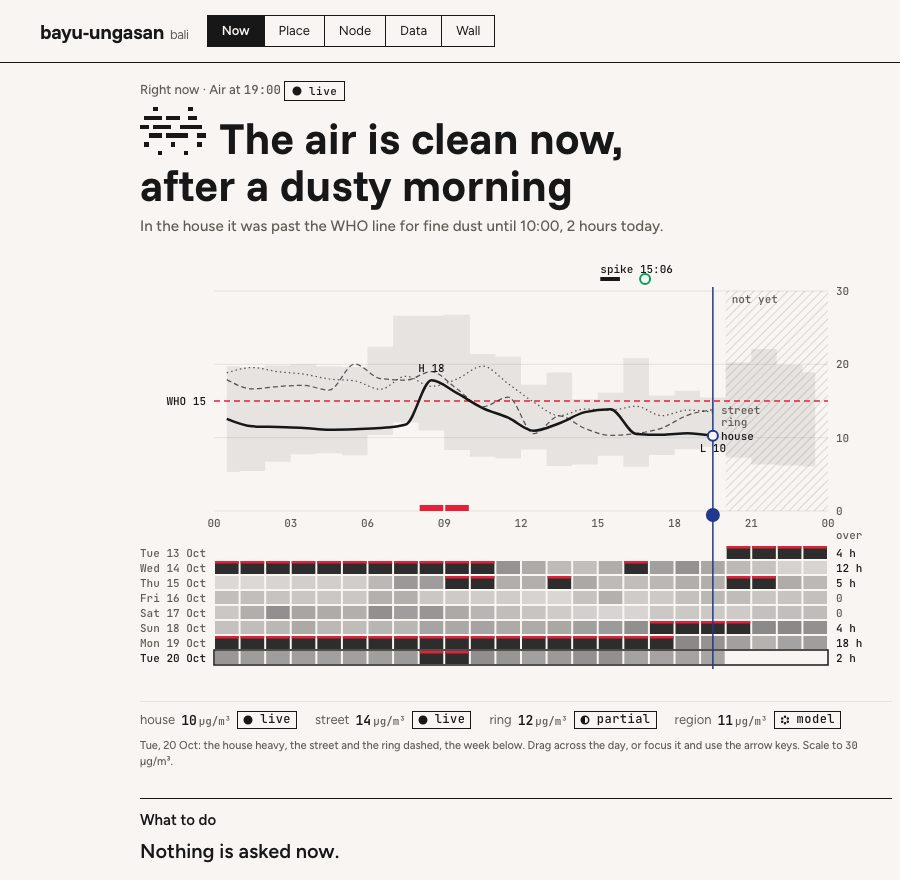

# First ten minutes
<!-- checked: v0.83.0 -->

The install ends with a node that reads your place and has nobody to tell. In the next ten minutes you add the
rest of the loop: a channel to your phone, one alert that goes all the way through, a person's answer recorded
against it, and the first value of [ρ](rho.md), the share of act-level alerts somebody answered. After that the
node can measure whether anybody acted on what it said, which only this layer can do.

## 1. See that it is reading

```bash
planetai status
```

```
  node      <name>   <version>   schema <schema>
  up        <h>h <m>m   polls <n>   readings <n>
  last poll <time of the last poll>
  errors    none
  sensors   none of yours yet (models only)
  reference <n>: <the first four public stations and models it reads>
  alerts    0 so far
  rho       not yet measured  (0/0 act-level alerts answered, 30d)
```

The angle brackets are this node's own figures. `polls` goes up by one every `POLL_SECONDS` (300), and
`errors none` means every source answered. With a Smart Citizen kit configured, `sensors` names it.

**Now there is:** sense. The poll loop is running and the models for your coordinates are in the database.

## 2. Connect Telegram

```bash
planetai telegram
```

Make a bot with **@BotFather** (`/newbot`) and paste its token when asked. Then open a chat with your bot and
send it any message, because a bot cannot start a conversation; the command waits up to two minutes for it.
When it worked:

```
● token works. Your bot is @<yourbot>
● found your chat: <chat id>
● sent you a hello
● the node is restarting with Telegram on. Try:  planetai test-alert
```

Your phone shows "&lt;name&gt; is connected. Alerts will arrive here." The command writes `TELEGRAM_BOT_TOKEN` and
`TELEGRAM_CHAT_IDS` to `.env` and to the running node. For more people, comma-separate their chat ids in
`TELEGRAM_CHAT_IDS`. Once the bot answers messages ([step 6](#6-talk-to-it)), a chat that is not in that list
is told once that the node answers its household only, with its own chat id to add.

**Now there is:** a channel. An alert has somewhere to go that a person will see.

## 3. Prove the whole path

```bash
planetai test-alert
```

```
  A rule that always fires has been added. The node checks rules every minute.
  Waiting......
● it fired. Alert #12 is in the log and on your phone.

  Now close the loop, which is the part the Index measures:
    planetai act 12
```

The command writes a temporary pack with one act-level rule that always fires, waits up to ninety seconds for
it, and removes the pack as soon as its alert appears, so the phone gets one test message. The message says:
"Test alert from your node. If you can read this, the whole path works: rule to message to you. Record it with
`planetai act <id>`." A quiet node is not a working node until this has happened once. The API has its own
test alert too, `POST /test-alert`.

**Now there is:** act. A rule fired, the alert is in `alerts`, and it went out on every channel the node has.

## 4. Close the loop

```bash
planetai act 12 "read the test alert on my phone"
```

```
● recorded: you acted on #12
  rho is now <ρ>  (<answered>/<asked> alerts answered, median <m> min)
```

Use the alert id the test printed. On a node whose only act-level alert is the test, ρ is now `1.0`, one of
one. Write what you did in your own words, because the note is the record. Without one the CLI writes the
placeholder `acted`, and the bot and the MCP `act` tool refuse a blank note.

**Now there is:** measure. There is a row in `actions` and ρ has a value: every act-level alert answered
within 24 hours, over the last 30 days.

## 5. Open the dashboard

```bash
planetai ui
```



```
  On this machine:      http://localhost:8080/
  On your network:      http://<lan ip>:8080/

  SHARE_LEVEL is off, so a screen on your network gets the dashboard and the node's status and no readings.
```

Below that it prints three tokens and creates the admin and act tokens if they are missing. The admin token is
for Set up: "Anyone with it can change what the node reads and where it sends alerts. Treat it like a
password." The backup token is read-only, for a NAS. The act token closes a loop from a phone and "cannot
read a secret or change a setting".

1. Open `http://localhost:8080/`. At the default `SHARE_LEVEL=off` every browser, including one on the node's
   own machine, sees the node's name and status and no readings. The page opens on the five doors, Now,
   Place, Node, Data and Wall, with **Set up** behind the gear. A phone is sent to the phone page.
2. In Set up › This screen, paste the admin token (or the act token, in "Token for closing a loop") and press
   **Unlock this screen**. The readings appear.
3. With the admin token in, "A phone" shows a QR code. Scan it and the phone page opens holding the act token,
   so the phone can answer the node with nothing typed.

Set up is also where you add sensors (Sources), choose the bot's model (Model) and change any setting without
touching `.env`. The classic page, with its Simple, Advanced and Learn modes, is at `/?layout=classic`. See
[Dashboard](dashboard.md) and [Sharing](sharing.md).

The Place door and the Wall draw streets, buildings and their names once the node holds the map of its place.
If you skipped it during install, fetch it now:

```bash
planetai run place basemap
```

It cuts OpenStreetMap out of Protomaps' daily build in three rings round the node, down to street level, and
adds drone imagery where somebody flew. `build.protomaps.com` and OpenAerialMap learn which square it fetched
(`GROUND_RADIUS_KM`, 12 km by default); after that every tile is read from `out/ground/`. `--dry-run` says what
it would ask for. Until it has run, `planetai doctor` lists **The map of this place** under what is left to
set up.

**Now there is:** the loop on a screen, drawn from the node's `GET /issues` document.

## When a real alert arrives

The test alert belongs to no issue, so it counts in ρ but never shows as an open alert on the page. The first
real act-level alert from an air or heat rule does. It closes on the classic page's Now view
(`/?layout=classic`); the doors and the phone page draw only an event's card. Until then Decide says "This
node sends alerts, not events." and "Nothing is asking for anything."

1. **Read it under Decide**, the first section under the lead. Each open alert has a card with *what was
   seen*, the alert's first line, and *what this node suggests*, the rule's 👉 recommendation. Press
   **Decide about this**, fill in "Who is deciding" and "What will be done" (or press **Take its word**),
   then **Record the decision**. The page confirms the decision and reminds you to press **I did this** when
   it is done. A decision closes no alert and does not enter ρ; it records that somebody looked.
2. **Record it when it is done.** Press **I did this** on the same card, fill in "Who" and "What you did",
   then **Record it**. The page answers "Recorded. The node watches what happens next." This needs the act
   or admin token in the browser; without one the node refuses and the page says where the token comes from.
3. **See it under Measure.** "Whether it worked" shows ρ, answered over asked, and the median minutes from
   alert to answer, the same figure as the `rho` line of `planetai status`. The funnel counts asked,
   acknowledged, acted and measured. `measured` goes up 48 hours after the act if the same rule has stayed
   silent on the same sensor, and "Which of these worked" shows it rule by rule.

A node on `ALERT_ENGINE=events` or `shadow` shows one card per open event instead, with the action for the
readings as they are now and **Done**, **Not now** and **Doesn't fit**; see [Dashboard](dashboard.md#decide).

**Now there is:** the whole loop on one page, and a ledger of who decided and who did what.

> **Note.** `DECISION_REQUIRED=1` (Set up → Alerts, off by default) makes the node refuse an act, with HTTP 409,
> unless a decision was recorded against the same alert first. It is for a node that acts for a street rather
> than a house.

## 6. Talk to it

```bash
planetai agent local
```

It installs Ollama if it is missing, starts it as a service, and recommends a model without downloading it:

```
● machine has 16 GB
● no model is on this machine yet, and this command does not fetch one.
     For 16 GB the recommendation is  qwen3.5:9b  (6.6 GB on disk, Apache-2.0)
     Pull it when you want it:   planetai agent local pull qwen3.5:9b
```

Under 16 GB the recommendation is `qwen3.5:4b` (3.4 GB). `planetai agent local pull <tag>` downloads it and
points `AGENT_MODEL` at it. The command then builds and starts the `agent` container, which answers your
Telegram messages with the node's own tools, and ends with "running. Message your bot: is the node healthy?
/act 23 closed the windows /model". On Linux it also sets `OLLAMA_URL=http://172.17.0.1:11434` and warns that
Ollama must listen on `0.0.0.0` so the container can reach it.

`/act 23` with no words gets a question back and records nothing. The local model gets the node's read and
act tools, never the admin ones. At the default, `AGENT_PREFER=private`, nothing the bot is asked leaves your
network. A bigger model on another machine of yours can sit above the local one on the
[model ladder](bot.md) (one at a public address counts as online), and an online model is used only after someone here chooses `fallback` or `strongest`
and sets a key.

**Now there is:** an agent on the node, answering from the node's own tools.

## Every day

```
planetai status      is it alive, what has it read, what fired, ρ
planetai doctor      every check, with the fix written next to any failure
planetai logs        what it is doing right now
planetai update      backup, fetch the latest version, check its signature, migrate, rebuild, verify
planetai storage     where the data is, where the copies go
```

`planetai doctor` prints one line per check: `✓`, `✗`, or an amber `!` for something worth saying that does
not fail the run, such as a new version being out. The fix is under every `✗` and `!`, after a `→`. Below the
checks, **Data sources** lists what the node needs for its basic job. It ends with `all good` or
`fix the marked lines, then run planetai doctor again`. A node installed from the release tarball also shows
`release signature verified on last update`.

A good week is a short report a few times a day, a handful of alerts, one or two that changed what you did,
and a fresh file in `backups/` every morning. Dozens of alerts a day means the thresholds are wrong for your
place. Write to us with which ones instead of raising them: a node that is quiet only because you raised its
threshold is lying to you.

## When something is off

Run `planetai doctor` first, then read [Troubleshooting](troubleshooting.md), which is ordered by what is on
your screen. To ask for help, write to **info@fab.city** with `planetai status`, `planetai doctor` and the last
twenty lines of `planetai logs`. Never send `.env`: it holds your tokens.

## Where this leads

The node now reads models and public stations. The next part is what measures your own place,
[Sensors and sources](sensors.md). With sensors indoors and out, a node can answer questions a model cannot.
On node #1, three indoor kits and one outdoor kit showed in their first week that the indoor PM2.5 followed
the street's, with the house holding back about a third of it, so what the house breathed came in from the
street. The `insight` pack's `agreement` rule says this every day, and when the room turns worse than the
street the `air-quality` pack's `inside_worse_ventilate` rule says to open a window. After sensors,
[the dashboard](dashboard.md) and [the report](report.md) are how you read the node, and [alerts](alerts.md)
are how it asks.
