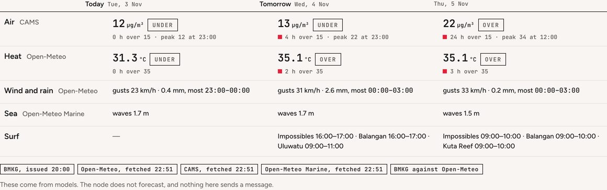

# Next days
<!-- checked: v0.91.0 -->

Next days is on Now, under What to do: the rest of today, tomorrow and the day after, read against the same lines Now
uses for what is happening. It shows whether the air will go over the line tonight, and whether tomorrow's surf is worth
getting up for. `#now/next` links straight to it.

Everything on it comes from forecasts the node fetches, from BMKG and from the models Open-Meteo serves. The node keeps
the next 72 hours of each, and judges air and heat against its own issues' lines, at its own point and across the
cells around it.

## What it shows

One row per thing, in the order of Now's rows, and three columns headed by weekday and date. Today runs from the next
whole hour to midnight in the node's time zone (`NODE_TZ`).

| row | the day's number | against |
|---|---|---|
| Air | the mean PM2.5 of the day's hours, in µg/m³, with the hour it peaks | the air issue's line, 15 µg/m³, the WHO 24-hour mean |
| Heat | the highest apparent temperature, in °C | the heat issue's line, 35 °C apparent |
| Wind and rain | the strongest gust, the day's rain in mm, and the three hours with the most of it | no line yet, so no state word |
| Sea | the highest wave, in m | no line; shown only while the `coast` pack is on |
| A pack's line | the pack's words for tomorrow and the day after | set by the pack |

A cell reads like "39.8 °C over, 2 h over 35", or "gusts 42 km/h · 9.0 mm, most 16:00–19:00".
Press a row and its 72 hours are drawn under it, with the line and a mark where now is.

Heat is worked out on the node, from the forecast's temperature and humidity, with the same function the heat issue
uses on the house's own sensors. Open-Meteo also publishes a "feels like" temperature, but it adds wind and sun, so it
would not be the same number as the line, and the node does not store it.

A pack adds its line with `ahead:` in its `pack.yaml` ([docs/PACKS.md](../../docs/PACKS.md) says how). The `surf`
wild pack writes the spots and windows that look good, "Uluwatu 16:00–18:00 · Impossibles 16:00–18:00", or "nothing
looks good". The node shows a pack's line only while the pack is on and only from a fetch made today, with each day's
text cut at 160 characters and shown as plain text.

## The state word

Air and heat carry a word, over, near or under, worked out by the engine's comparison against the issue's own
line. It is the same comparison that writes the state on Now and on each issue, so the two cannot disagree about what
"over" means. Beside it, "2 h over 35" counts the forecast hours above the line. BMKG gives a value every three hours, so each of its
values counts for three. A row whose issue is off on the node
is left out.

## Where each number comes from

| source | what the node keeps | where it answers | switch |
|---|---|---|---|
| BMKG, Indonesia's meteorological agency | temperature, humidity, wind, cloud and rain, every three hours | Indonesia, at the village code in `FORECAST_BMKG_ADM4` | `FORECAST_BMKG`, on by default |
| Open-Meteo | the weather hour by hour, with gusts, the chance of rain, sun, evaporation and soil moisture | anywhere | `FORECAST_OPENMETEO`, off by default |
| CAMS, the Copernicus air model, through Open-Meteo | PM2.5 and the UV index, hour by hour | anywhere | the same switch |
| Open-Meteo Marine | wave height, and the swell's height, period and direction | the sea cell nearest the node, refused past 30 km | the same switch, with the `coast` pack on |

Sun, evaporation and soil moisture are kept and not drawn on this page. Where BMKG and Open-Meteo both give the
temperature or the rain, the row takes Open-Meteo's hours and says so beside its title, and `GET /forecast` lists BMKG under `also`.

Under the rows each source has a pill with its time: BMKG says when it issued its forecast, and Open-Meteo, which
publishes no model run time, says when the node fetched it. A source more than 10 km from the node says how far. After
the pills comes the sentence "These come from models. The node does not forecast, and nothing here sends a message.",
and with Open-Meteo off, the line about turning it on follows it.

## Turning Open-Meteo on

Open-Meteo's free tier is for non-commercial use only. Whether your node fits that is your decision as its operator,
so the three Open-Meteo sources stay off until you turn them on. One switch turns on all three, in Set up → Packs →
forecast or with `planetai config set FORECAST_OPENMETEO 1`.

With it off, Next days shows BMKG's heat, wind and rain where BMKG covers the node, with no gusts, and after the
models sentence one more line: "Air, the sea and more hours come from Open-Meteo, which is off on this node. Turn it on
in Set up → Packs → forecast." Outside Indonesia nothing answers with it off, so the page says that in one line, with
the same link, in place of the grid.

## Territory and scale

The node asks Open-Meteo and CAMS for the ground it covers, at its `NODE_SCALE`, in one request per source:

| `NODE_SCALE` | points |
|---|---|
| `community` (the default) | 7, the node's resolution-7 H3 cell and the six around it |
| `city` | 19, the node's resolution-6 cell and two rings around it |
| `region` | 19, the node's resolution-5 cell and two rings around it |

The node's own point is at its coordinates, the others at their cells' centres, and each one is a sensor
(`forecast-om-<cell>`, `forecast-cams-<cell>`) tagged with the cell it was asked for. BMKG and the sea stay one point.
The number in a row is the node's own point. The models are coarser than the cells, Open-Meteo's weather works on a grid
of about 10 to 25 km and CAMS on about 44 km, so several of the seven points usually come back from the same model
cell. Next days counts the model's own grid points, where each sensor was answered from, and when there are two or
more, air and heat add how many of them go over the line, "over in 1 of 3 cells". Open-Meteo counts each location as one call against a daily limit per IP. On a community
node each poll sends 7 locations for the weather and 7 for the air, beside the wind field's 65 and, while `coast` is
on, one for the sea.

## When a forecast is revised

Each source is asked every `FORECAST_POLL_HOURS` (6 by default), and a newer forecast for an hour the node already
holds replaces the older value, so tomorrow at 15:00 always shows the latest run. An hour that has passed is never
rewritten, and the rule touches only forecast rows (the `fc_` metrics), so a sensor whose clock runs ahead cannot
overwrite a measurement. A source that fails is asked again after 30 minutes, and the others carry on.

## Nothing here sends a message

The forecast pack fetches and stops. It does not predict, and its one rule, `ahead`, gives the daily report a line
about wind and rain, with no level and no message. [tests/test_forecast.py](../../tests/test_forecast.py) fails if a
rule here is anything but a report line or carries a message. Next days only draws what the pack fetched, and asks
nothing of the household. A forecast is never read as a measurement either. Its channels are `derived` and not
comparable, so a forecast never counts in a cell, and Now's live figures never read one.

## Reading it from a script

`GET /forecast?hours=72` answers what the page draws. Beside the hours and the sources it carries `days`, one entry a
day with `part` (`rest` for today, `day` for the others) and `rows` keyed `air`, `heat`, `wind_rain` and `sea`; `lines`,
each pack's line in English, Spanish and Indonesian; and `openmeteo`, whether the switch is on. The shape is the wire
contract `forecast-v0` ([tests/data/wire/forecast-v0.json](../../tests/data/wire/forecast-v0.json)), and
[the API](api.md) has the route.

The forecast pack's settings are in [the packs reference](packs-reference.md), and the rest of Now is on
[the dashboard](dashboard.md) page.
