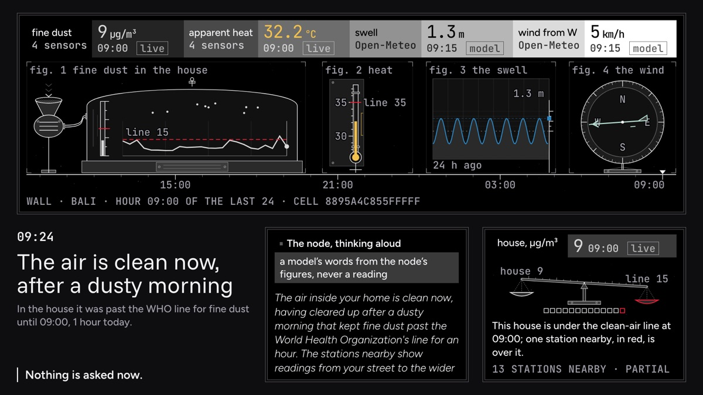

# Wall mode
<!-- checked: v0.91.0 -->

The Wall is the node on a screen in a living room or a lab, read from about three metres by people who know nothing
about air science, and operated by nobody. It shows the moment, what is asked of the house and what the node's model
makes of it. It asks nothing itself: an answer belongs where somebody can write one, on Telegram, over the radio or on
the dashboard.

```
http://<node>:8080/#wall
```

## Putting one up

1. **Let the house read the node.** A wall screen carries no token, so it needs `SHARE_LEVEL=open`:
   `planetai config set SHARE_LEVEL open`, or Set up › Sharing. At `off` the Wall draws one line, "This screen needs
   sharing turned on.", and never a token form.
2. **Open `/#wall` on the screen.** You should see, in the dark register and inside one viewport, the instruments
   across the top, and under them the node's sentence, its own words once its model has written them, and the
   balance. The bar and the foot of the other doors are gone.
3. **Leave it.** The instruments replay the last 24 hours by themselves, an hour a step. If the screen has reduced
   motion on, nothing moves: the Wall holds the last hour.
4. **Reload it now and then.** The Wall reads the node when the page opens.

> **Gap in v0.91.0.** The Wall does not re-read the node while it stays open: its figures are those of the moment it
> was opened, and only the narration is new every ten minutes. Reload the screen, or put the classic wall up instead,
> which re-reads on `POLL_SECONDS`.

## What it shows



Nothing on the Wall is smaller than 28 px at 1920×1080, and the type scales with the screen. What did not fit at that
size was cut. It reads in one order:

- **The instruments**, across the top (see below).
- **The time and the sentence**: the headline issue's title as the node writes it, with what is asked now beside it:
  the node's own sentence, how many things are asked of the house, and "Answer on Telegram, not here.", or "Nothing is
  asked now." When the node's last poll is more than 15 minutes old, the time says the readings are old.
- **The node, thinking aloud**, in its own screen beside the sentence, only once there is text.
- **The balance**: the house's fine dust in one pan and the clean-air line in the other, tipped by the heavier, and
  under it the outdoor stations nearby, one square each, red when it is over the line. A caption says it in words ("This
  house is under the clean-air line at 19:00; 3 stations nearby, in red, are over it"), at the hour the instruments show.

The back button and a note naming the model are chrome: hidden until a pointer is over them or the keyboard reaches
them, and always shown as 44 px targets on a touch screen. On a phone, a portrait screen or a small TV everything
stacks, the instruments first.

## The instruments

One black screen holds four instruments, each drawing one reading the node has, in line art on a rail:

| instrument | what it draws | from |
|---|---|---|
| fine dust | a jar with the air drawn into it: one particle for every µg/m³ of the hour, up to 60, settling a band an hour; a tube standing at the hour; the day's curve against the line, red and dashed | the air issue, at its headline distance |
| apparent heat | a thermometer at the hour, the house's own heat line a red tick across it | the heat issue |
| the swell | the last 24 hours as a wave, left to right, its height the hour's swell, with a staff at the hour | Open-Meteo's marine model |
| the wind | a vane turned to where the wind comes from, one streak behind it for every 5 km/h, up to 40 | Open-Meteo |

Over them a strip names each reading, says where it is from, and gives its figure, its hour and a provenance word.
Each reading keeps its own colour on its lines and its figure, and red is only ever the line.

Each instrument sits on its own plate, in greys under fine lines, and carries some of the day with it: the thermometer
a bracket for the day's range, the swell a dashed line at the day's highest, the dial a mark for each hour's bearing so
far, fading with age. The scale under them is the day being replayed, an hour a tick, every six hours said and counted
back from now, with a marker stepping along it at the hour shown.

The instruments replay the last 24 hours, an hour every 1.25 s (30 s for the day), hold the last hour, then start the
day again. Each hour is a step, never a slide, and nothing counts up. An instrument the node does not read says
so. Without the admin token the sea and the wind come from the newest reading, which stands for every
hour with its own time.

Every figure says when it is from and carries a provenance word. A source is named the way the Wall says it
("Open-Meteo", "3 sensors"), and a sensor's name never appears.

## The node, thinking aloud

Every ten minutes the Wall asks `POST /ask` with `prompt: wall`, so the model is the one chosen in Set up › Model
(`AGENT_PREFER`). The node tells it to speak like a calm neighbour in six to eight plain sentences: what is happening
inside, how it compares with the street and the neighbourhood, what it suggests for an ordinary day, and what the next
hours may bring, with no units, at most two numbers, and never saying that anything is safe. The model is offered no
tools, since every fact it may use is in the request, so it answers without thinking first: a few seconds on node #1's
remote model, where thinking had taken more than four minutes and the box stayed empty. The Wall types the text at a
reading pace. A story taller than its box then rolls up, a line every three seconds, in a loop that brings its start
round again; under reduced motion it stands still at its start. The last text stays up while the next is written,
held in the page's memory and never stored. The
box calls itself a model's words from the node's figures, never a reading, and says "written online" when the
keeper's choice sent the question out. With no model on the node, or `UI_ASK=off`, there is no box.

The node gives the model only public facts, each a short labelled line with its unit and where it comes from (`live`,
`model` or `satellite`): the time of day; each watched issue's day sentence, its values inside the home, on the
street, in the neighbourhood and in the wider area, its line and its trend; every issue's readouts, such as the land's
built and tree share and the sea's swell; how many public stations nearby read fine dust and how many are over the WHO
line; what is usual for the place (from the outdoor sensors only); the next six hours of forecast; and
every section a pack declares with `wall: true`. Each narration starts from an angle those facts can carry (the day so
far, the stations around, what is usual here, the next hours, the land and the sea, fires, the ground's heat), and an
angle with no facts is skipped.

## What the Wall never shows

Anyone in the room reads the Wall, so it names no sensor, room, kit or person, and the model's facts carry none of
them either. What is asked is the node's own sentence, never the alert's text, which can name a room. It never shows
what the house learned, its diary, its things, a position or a button to answer. It is always dark, whatever register
the other doors are in.

## The classic wall

`/?layout=classic#wall` opens the classic dashboard's wall, which re-reads the node on `POLL_SECONDS` like every
classic view. The line `planetai ui` prints for a wall screen (add `#wall`, it moves its own ladder, it needs
`SHARE_LEVEL=open`) describes this one, although on `/` the same `#wall` opens the doors' Wall. At `off` it draws the
refused page in the dark register, with the node's own sentence.

**The top bar**, from the left: a **back** button, first in keyboard order; up to four metric chips (the one shown
first, then the node's order, and "+N more" for `?vars=all`; `?var=` picks one, default `pm25`); the node's name, its
city, `#wall`, a share level, and "the ladder moves every 8 s" or, under reduced motion, "the ladder stands still";
and at the right the variable, its unit and `15-min means`.

**The grid.** Nineteen H3 cells, the node's own and two rings around it, at the current resolution, with no map under
them. A cell with one station holds its 15-minute mean and its name; with several, how many and the range; the node's
own cell, each of its own stations. An empty cell is drawn and left empty.

**The ladder** is drawn as hexagons: the current rung filled ink, a rung whose cell may leave the machine filled in the
cells blue at 0.16, a rung finer than the published resolution dashed. Every eight seconds it steps to the next rung
and the grid re-draws, with no tween between rungs. Pressing a rung or a cell, or an arrow key, holds it for thirty
seconds. Under `prefers-reduced-motion: reduce` nothing moves.

**The right column** has the headline issue (kicker, title, tagline, why and the alert), then "Answer on Telegram, not
here.", the ladder with its key, the counts (cells with a station, stations in the node's cell, and of them its own),
and the ρ row. The ρ row counts rings and never sizes them: one ring per alert up to 40, one per 10 up to 400, then one
per 100, with the unit and the exact counts under it. Under the grid, the first five fragments the sections contribute
through `wall()`, then "+N more in Now". The classic wall shows open alerts, not alert events, so on a node whose
engine is `shadow` or `events` it can read "Nothing has been asked." while Decide has an event open.

**The foot** has the as-of time, the version and the motion caption. When a poll got no answer the as-of time reads
"Read at … · the node has not answered for N min". If the wall throws while it draws, it says "The wall did not
render:" and why, rather than going black.

> **Gap in v0.91.0.** On the classic wall the share level in the top bar always reads `off`, because `/health`
> carries no share level, and the bold `stale` in the foot is a fixed label that shows whether or not the node is
> answering. The as-of time beside it is the one to read.

## Where this leads

Whatever the Wall shows as asked is answered on Telegram, over the radio or on the dashboard, and each of them writes
the same row in `actions`: see [Channels](channels.md) and [the dashboard](dashboard.md). What the ρ row counts is
[ρ](rho.md), and how the Wall is drawn is [Design](design.md).
