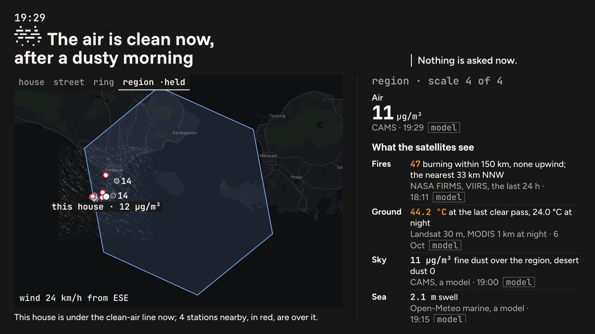

# Wall mode
<!-- checked: v0.90.0 -->

The Wall is the node on a screen in a living room or a lab, read from about three metres by people who know nothing
about air science, and operated by nobody. It shows the moment, what is asked of the house and what the node's model
makes of it. It asks nothing itself: an answer belongs where somebody can write one, on Telegram, over the radio or on
the dashboard.

```
http://<node>:8080/#wall
```

## Putting one up

1. **Let the house read the node.** A wall screen carries no token, so it needs `SHARE_LEVEL=open`:
   `planetai config set SHARE_LEVEL open`, or Set up › Sharing. At `off` the Wall draws one line, "This screen needs
   sharing turned on.", and never a token form.
2. **Open `/#wall` on the screen.** You should see, in the dark register and inside one viewport, the time and the
   node's sentence at the top, the map of the stations around the house on the left, and the page for one scale on
   the right. The bar and the foot of the other doors are gone.
3. **Leave it.** The map walks out from the house by itself, one scale at a time, replaying each scale's day an hour
   a step. If the screen has reduced motion on, nothing moves: the Wall holds the street at the last hour.
4. **Reload it now and then.** The Wall reads the node when the page opens.

> **Gap in v0.90.0.** The Wall does not re-read the node while it stays open: its figures are those of the moment it
> was opened, and only the narration is new every ten minutes. Reload the screen, or put the classic wall up instead,
> which re-reads on `POLL_SECONDS`.

## What it shows



Nothing on the Wall is smaller than 28 px at 1920×1080, and the type scales with the screen. What did not fit at that
size was cut. It reads in one order:

- **The time and the sentence**: the headline issue's title as the node writes it, with what is asked now beside it:
  the node's own sentence, how many things are asked of the house, and "Answer on Telegram, not here.", or "Nothing is
  asked now." When the node's last poll is more than 15 minutes old, the time says the readings are old.
- **The map**: the stations around the house on the node's own map, framed on the scale's H3 cell, with the wind. The
  house is one mark and a public station a disc, red when it is over the line. A caption under the map says in words
  what the red discs mean against the house ("This house is under the clean-air line now; 3 stations nearby, in red,
  are over it"), at the hour the discs show.
- **The scale's page**, beside the map (see below).
- **The node, thinking aloud**, under the page, only once there is text.

The back button, up to four metric chips (only metrics a station on this node reads) and a note naming the model are
chrome: hidden until a pointer is over them or the keyboard reaches them, and always shown as 44 px targets on a touch
screen. On a phone, a portrait screen or a small TV the two columns stack, the map first.

## The walk

The map walks out from the house in four scales, each framed on its own H3 cell, drawn blue with the smaller cells
faint inside it:

| scale | H3 resolution | the page beside the map |
|---|---|---|
| house | 10 | each issue's figure in the house, and the day in the house |
| street | 9 | the street's figures, the replayed hour in words ("Air at 19:00: house 7 · street 11 · ring 8 µg/m³"), and the street's day against what the node learned is usual outside at each hour, dotted (`GET /learned/place`) |
| ring | 6 | the land within 1 km as a hundred squares by kind (built, trees, crops, water; land cover by satellite), and the places OpenStreetMap maps there, counted. It says when the map tags too few buildings as shops or offices to tell homes from shops |
| region | 3 | what the satellites and models see around: fires within 150 km (NASA FIRMS, `fire` pack), the ground's heat at the last clear Landsat pass and at night (`surface-heat`), fine dust over the region (CAMS), the sea's swell, each only where the node reads it, and floods as not watched on this node yet |

Each scale holds while its day is replayed, 24 hours in 30 s, then the walk cuts to the next. A new scale is a cut,
never a flight. The four scale names on the map say which one is drawn: pressing one holds it, pressing it again lets
the walk go on.

Every figure says when it is from and carries a provenance word. A figure from `/observations` takes the node's rule
for readouts (`model` for a model, `partial` otherwise), and what the node learned is `partial`. A source is named the
way the Wall says it ("Sea, 5 km off"), and a sensor's name never appears.

## The node, thinking aloud

Every ten minutes the Wall asks `POST /ask` with `prompt: wall`, so the model is the one chosen in Set up › Model
(`AGENT_PREFER`). The node tells it to speak like a calm neighbour in six to eight plain sentences: what is happening
inside, how it compares with the street and the neighbourhood, what it suggests for an ordinary day, and what the next
hours may bring, with no units, at most two numbers, and never saying that anything is safe. The model is offered no
tools, since every fact it may use is in the request, so it answers without thinking first: a few seconds on node #1's
remote model, where thinking had taken more than four minutes and the box stayed empty. The Wall types the text at a
reading pace. A story taller than its box then rolls up, a line every three seconds, in a loop that brings its start
round again; under reduced motion it stands still at its start. The last text stays up while the next is written,
held in the page's memory and never stored. The
box calls itself a model's words from the node's figures, never a reading, and says "written online" when the
keeper's choice sent the question out. With no model on the node, or `UI_ASK=off`, there is no box.

The node gives the model only public facts, each a short labelled line with its unit and where it comes from (`live`,
`model` or `satellite`): the time of day; each watched issue's day sentence, its values inside the home, on the
street, in the neighbourhood and in the wider area, its line and its trend; every issue's readouts, such as the land's
built and tree share and the sea's swell; how many public stations nearby read fine dust and how many are over the WHO
line; what is usual for the place (from the outdoor sensors only); the next six hours of forecast; and
every section a pack declares with `wall: true`. Each narration starts from an angle those facts can carry (the day so
far, the stations around, what is usual here, the next hours, the land and the sea, fires, the ground's heat), and an
angle with no facts is skipped.

## What the Wall never shows

Anyone in the room reads the Wall, so it names no sensor, room, kit or person, and the model's facts carry none of
them either. What is asked is the node's own sentence, never the alert's text, which can name a room. It never shows
what the house learned, its diary, its things, a position or a button to answer. It is always dark, whatever register
the other doors are in.

## The classic wall

`/?layout=classic#wall` opens the classic dashboard's wall, which re-reads the node on `POLL_SECONDS` like every
classic view. The line `planetai ui` prints for a wall screen (add `#wall`, it moves its own ladder, it needs
`SHARE_LEVEL=open`) describes this one, although on `/` the same `#wall` opens the doors' Wall. At `off` it draws the
refused page in the dark register, with the node's own sentence.

**The top bar**, from the left: a **back** button, first in keyboard order; up to four metric chips (the one shown
first, then the node's order, and "+N more" for `?vars=all`; `?var=` picks one, default `pm25`); the node's name, its
city, `#wall`, a share level, and "the ladder moves every 8 s" or, under reduced motion, "the ladder stands still";
and at the right the variable, its unit and `15-min means`.

**The grid.** Nineteen H3 cells, the node's own and two rings around it, at the current resolution, with no map under
them. A cell with one station holds its 15-minute mean and its name; with several, how many and the range; the node's
own cell, each of its own stations. An empty cell is drawn and left empty.

**The ladder** is drawn as hexagons: the current rung filled ink, a rung whose cell may leave the machine filled in the
cells blue at 0.16, a rung finer than the published resolution dashed. Every eight seconds it steps to the next rung
and the grid re-draws, with no tween between rungs. Pressing a rung or a cell, or an arrow key, holds it for thirty
seconds. Under `prefers-reduced-motion: reduce` nothing moves.

**The right column** has the headline issue (kicker, title, tagline, why and the alert), then "Answer on Telegram, not
here.", the ladder with its key, the counts (cells with a station, stations in the node's cell, and of them its own),
and the ρ row. The ρ row counts rings and never sizes them: one ring per alert up to 40, one per 10 up to 400, then one
per 100, with the unit and the exact counts under it. Under the grid, the first five fragments the sections contribute
through `wall()`, then "+N more in Now". The classic wall shows open alerts, not alert events, so on a node whose
engine is `shadow` or `events` it can read "Nothing has been asked." while Decide has an event open.

**The foot** has the as-of time, the version and the motion caption. When a poll got no answer the as-of time reads
"Read at … · the node has not answered for N min". If the wall throws while it draws, it says "The wall did not
render:" and why, rather than going black.

> **Gap in v0.90.0.** On the classic wall the share level in the top bar always reads `off`, because `/health`
> carries no share level, and the bold `stale` in the foot is a fixed label that shows whether or not the node is
> answering. The as-of time beside it is the one to read.

## Where this leads

Whatever the Wall shows as asked is answered on Telegram, over the radio or on the dashboard, and each of them writes
the same row in `actions`: see [Channels](channels.md) and [the dashboard](dashboard.md). What the ρ row counts is
[ρ](rho.md), and how the Wall is drawn is [Design](design.md).
